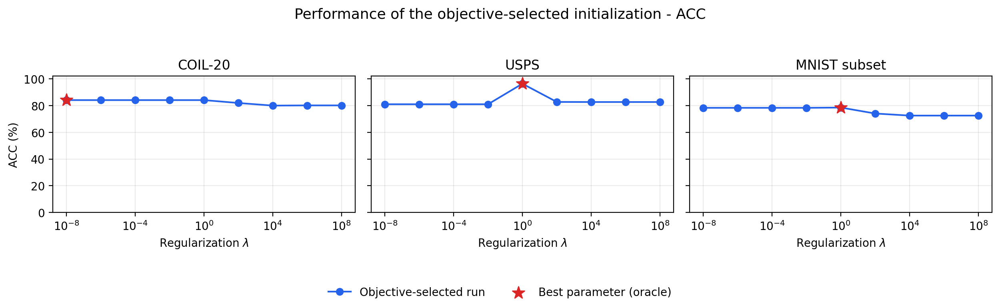
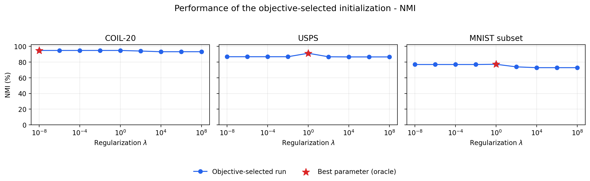
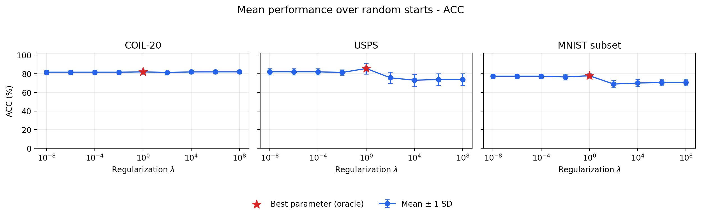
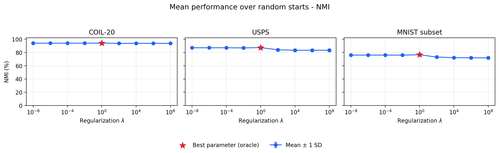

# LDMGI reproduction results

These are independently reproduced experiments on three datasets. The four tables follow the reporting structure of Tables II-V in Yang et al. (2010), restricted to LDMGI. Published baseline methods have not been rerun and are not presented as reproduced results.

## Selection rules

- Best ACC/NMI: at each regularization value, use the valid run with the smallest discrete LDMGI objective; then select the parameter with the highest ACC or NMI, respectively. This is not the maximum metric over all individual seeds.
- Mean ACC/NMI: compute the mean over all saved starts at each parameter, then select the parameter with the highest mean of that metric. Report its standard deviation (ddof=0).
- Parameter selection by ACC/NMI uses ground truth for oracle benchmark reporting. It is not a label-free deployment rule. ACC and NMI are selected independently; ties use the smallest lambda.
- Do not compare raw objective values between regularization parameters. Published values are transcribed from the LDMGI columns of the original paper, not computed by this repository.
- The MNIST subset indices are not verified as the authors' MNIST-T subset. Image scaling and COIL interpolation are explicit implementation choices. Higher reproduced scores do not establish an algorithmic improvement or an exact replication.

## Table II: Best ACC (%)

| Dataset | Published LDMGI | Reproduced LDMGI | Selected lambda | Selected seed |
| --- | ---: | ---: | ---: | ---: |
| COIL-20 | 82.4 | 84.03 | 1e-08 | 0 |
| USPS | 81.5 | 96.28 | 1 | 4 |
| MNIST subset | 72.8 | 78.46 | 1 | 19 |

## Table III: Best NMI (%)

| Dataset | Published LDMGI | Reproduced LDMGI | Selected lambda | Selected seed |
| --- | ---: | ---: | ---: | ---: |
| COIL-20 | 91.1 | 94.68 | 1e-08 | 0 |
| USPS | 86.5 | 91.12 | 1 | 4 |
| MNIST subset | 69.2 | 77.10 | 1 | 19 |

## Table IV: Mean ACC and standard deviation (%)

| Dataset | Published LDMGI | Reproduced LDMGI | Selected lambda | Starts |
| --- | ---: | ---: | ---: | ---: |
| COIL-20 | 75.3 ± 4.9 | 81.95 ± 1.89 | 1 | 20 |
| USPS | 80.5 ± 5.6 | 85.50 ± 5.75 | 1 | 20 |
| MNIST subset | 71.5 ± 3.5 | 77.76 ± 2.05 | 1 | 20 |

## Table V: Mean NMI and standard deviation (%)

| Dataset | Published LDMGI | Reproduced LDMGI | Selected lambda | Starts |
| --- | ---: | ---: | ---: | ---: |
| COIL-20 | 90.0 ± 0.7 | 94.00 ± 0.66 | 1 | 20 |
| USPS | 86.1 ± 2.3 | 87.20 ± 1.73 | 1 | 20 |
| MNIST subset | 68.9 ± 1.5 | 76.50 ± 0.95 | 1 | 20 |

## Regularization curves

The two primary figures follow the paper's objective-selected-initialization convention. Each panel shows one dataset. The horizontal axis is logarithmic; stars mark label-based best parameters, not automatically deployable settings. No curves have been invented for unimplemented baseline algorithms.

Supplementary mean curves show the mean and one standard deviation at every parameter. These error bars describe variation across initializations, not confidence intervals.

All four tables are exported as Markdown, CSV, LaTeX (booktabs), PNG and SVG. Figures are exported as PNG and SVG, with their numeric data in `regularization_curves.csv`. `selections.json` records the exact parameters and seeds used in the tables.

## Cluster diagnostics at fixed lambda = 1

The following representative runs use the smallest discrete objective among starts at lambda=1. Cluster IDs have no intrinsic class meaning. Correctness uses global one-to-one Hungarian matching.

### COIL-20

Samples: 1440; features: 1024; seed: 11; ACC: 84.03%; NMI: 94.68%.

| Cluster | Size | Matched class | Class total | Correct | Wrong | Precision (%) | Recall (%) |
|---|---:|---:|---:|---:|---:|---:|---:|
| 0 | 216 | 3 | 72 | 72 | 144 | 33.3 | 100.0 |
| 1 | 62 | 5 | 72 | 62 | 0 | 100.0 | 86.1 |
| 2 | 82 | 7 | 72 | 72 | 10 | 87.8 | 100.0 |
| 3 | 30 | 6 | 72 | 0 | 30 | 0.0 | 0.0 |
| 4 | 31 | 2 | 72 | 31 | 0 | 100.0 | 43.1 |
| 5 | 83 | 8 | 72 | 72 | 11 | 86.7 | 100.0 |
| 6 | 35 | 19 | 72 | 0 | 35 | 0.0 | 0.0 |
| 7 | 72 | 9 | 72 | 72 | 0 | 100.0 | 100.0 |
| 8 | 72 | 1 | 72 | 72 | 0 | 100.0 | 100.0 |
| 9 | 37 | 13 | 72 | 37 | 0 | 100.0 | 51.4 |
| 10 | 72 | 18 | 72 | 72 | 0 | 100.0 | 100.0 |
| 11 | 72 | 4 | 72 | 72 | 0 | 100.0 | 100.0 |
| 12 | 72 | 20 | 72 | 72 | 0 | 100.0 | 100.0 |
| 13 | 72 | 14 | 72 | 72 | 0 | 100.0 | 100.0 |
| 14 | 72 | 12 | 72 | 72 | 0 | 100.0 | 100.0 |
| 15 | 72 | 16 | 72 | 72 | 0 | 100.0 | 100.0 |
| 16 | 72 | 15 | 72 | 72 | 0 | 100.0 | 100.0 |
| 17 | 72 | 17 | 72 | 72 | 0 | 100.0 | 100.0 |
| 18 | 72 | 10 | 72 | 72 | 0 | 100.0 | 100.0 |
| 19 | 72 | 11 | 72 | 72 | 0 | 100.0 | 100.0 |

[Image gallery](results/coil20/selected_reg1/cluster_examples.png) · [Cluster statistics](results/coil20/selected_reg1/clusters.csv) · [Per-image predictions](results/coil20/selected_reg1/samples.csv)

### USPS

Samples: 9298; features: 256; seed: 4; ACC: 96.28%; NMI: 91.12%.

| Cluster | Size | Matched class | Class total | Correct | Wrong | Precision (%) | Recall (%) |
|---|---:|---:|---:|---:|---:|---:|---:|
| 0 | 884 | 10 | 821 | 798 | 86 | 90.3 | 97.2 |
| 1 | 911 | 3 | 929 | 885 | 26 | 97.1 | 95.3 |
| 2 | 1551 | 1 | 1553 | 1532 | 19 | 98.8 | 98.6 |
| 3 | 710 | 9 | 708 | 669 | 41 | 94.2 | 94.5 |
| 4 | 679 | 6 | 716 | 660 | 19 | 97.2 | 92.2 |
| 5 | 855 | 4 | 824 | 794 | 61 | 92.9 | 96.4 |
| 6 | 838 | 7 | 834 | 817 | 21 | 97.5 | 98.0 |
| 7 | 794 | 8 | 792 | 765 | 29 | 96.3 | 96.6 |
| 8 | 1272 | 2 | 1269 | 1259 | 13 | 99.0 | 99.2 |
| 9 | 804 | 5 | 852 | 773 | 31 | 96.1 | 90.7 |

[Image gallery](results/usps/selected_reg1/cluster_examples.png) · [Cluster statistics](results/usps/selected_reg1/clusters.csv) · [Per-image predictions](results/usps/selected_reg1/samples.csv)

### MNIST subset

Samples: 5000; features: 784; seed: 19; ACC: 78.46%; NMI: 77.10%.

| Cluster | Size | Matched class | Class total | Correct | Wrong | Precision (%) | Recall (%) |
|---|---:|---:|---:|---:|---:|---:|---:|
| 0 | 394 | 6 | 500 | 374 | 20 | 94.9 | 74.8 |
| 1 | 744 | 4 | 500 | 451 | 293 | 60.6 | 90.2 |
| 2 | 319 | 5 | 500 | 293 | 26 | 91.8 | 58.6 |
| 3 | 500 | 0 | 500 | 488 | 12 | 97.6 | 97.6 |
| 4 | 699 | 7 | 500 | 464 | 235 | 66.4 | 92.8 |
| 5 | 570 | 1 | 500 | 496 | 74 | 87.0 | 99.2 |
| 6 | 123 | 9 | 500 | 0 | 123 | 0.0 | 0.0 |
| 7 | 699 | 3 | 500 | 460 | 239 | 65.8 | 92.0 |
| 8 | 469 | 8 | 500 | 439 | 30 | 93.6 | 87.8 |
| 9 | 483 | 2 | 500 | 458 | 25 | 94.8 | 91.6 |

[Image gallery](results/mnist/selected_reg1/cluster_examples.png) · [Cluster statistics](results/mnist/selected_reg1/clusters.csv) · [Per-image predictions](results/mnist/selected_reg1/samples.csv)

## Validation and provenance

The saved experiments contain 540 LDMGI starts. Run `python audit_results.py` to recompute metrics from saved predictions and verify cluster/sample reports. Run `python -m unittest -v` for numerical, reporting and table-selection tests.

USPS uses source class IDs 1-10; COIL uses object IDs 1-20. A pure cluster can have zero matched precision if its majority class is assigned to another cluster by the global one-to-one mapping. Purity and matched precision are intentionally separate.

Source: Yang et al., Image Clustering Using Local Discriminant Models and Global Integration, IEEE TIP 19(10), 2010, Tables II-V, DOI: 10.1109/TIP.2010.2049235. The published MNIST row is MNIST-T. Data hashes, software versions and all run-level scores are preserved in each dataset report.json.
