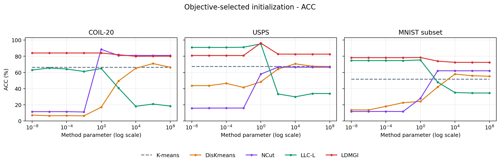
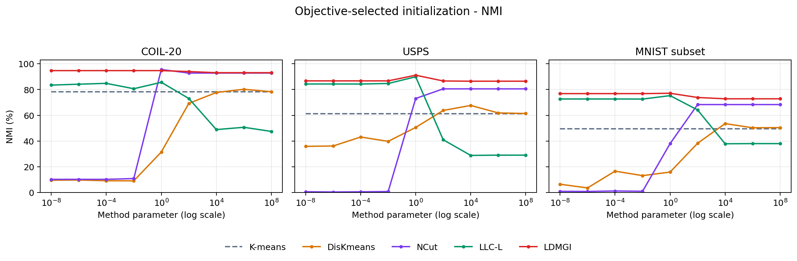
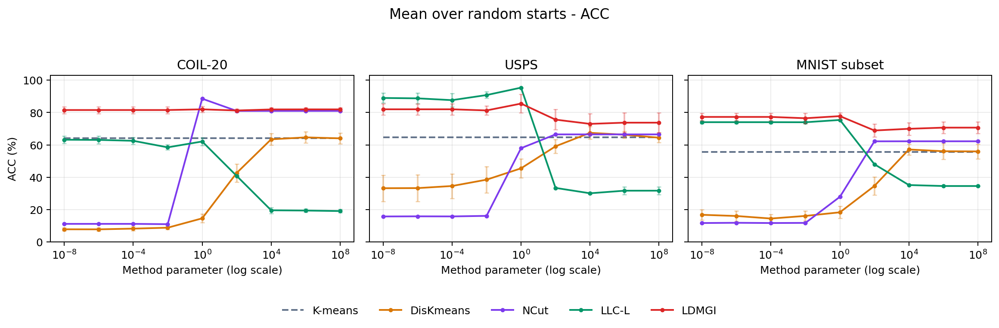
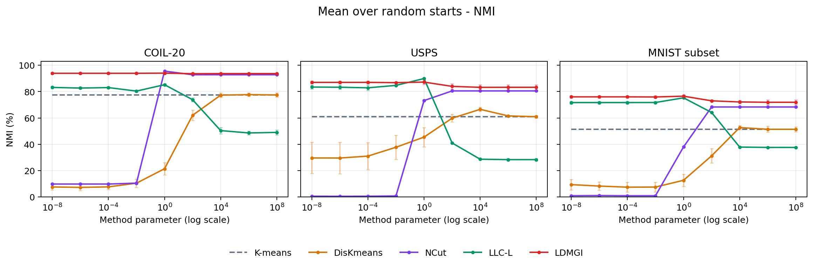

# Executed baseline and LDMGI comparison

Every algorithm column below is computed from runs in this repository on identical samples and features. No published score is substituted for a missing experiment. The earlier published-versus-reproduced LDMGI comparison is preserved in [LDMGI_REFERENCE_RESULTS.md](LDMGI_REFERENCE_RESULTS.md).

## Protocol

- K-means: 20 independent sklearn starts, n_init=1 each; minimum inertia selects the representative. No regularization parameter.
- DisKmeans: exact regularized discriminative-kernel feature transform, followed by sklearn K-means; 9 parameters x 20 starts.
- NCut: symmetric union 5-neighbor Gaussian graph, normalized Laplacian, Yu-Shi discretization; sigma is the bandwidth, not a ridge coefficient.
- LLC-L: linear-kernel local ridge prediction, five neighbors excluding the sample; spectral discretization of (I-A).T @ (I-A). This is not LLE and not LLC-G.
- LDMGI: the unchanged implementation and previously executed 9 x 20 starts.
- Best ACC/NMI: select minimum-objective initialization at each usable parameter, then independently select the best parameter for each metric. Mean tables select the best parameter by that metric's mean and report its standard deviation (ddof=0). This is oracle benchmark selection with labels, not a deployable unsupervised parameter rule.
- All methods use the same 0-19 seed set. NCut/LLC use five neighbors excluding self; LDMGI uses self plus four neighbors, following the local-set definitions. sklearn k-means++ initialization is an explicit implementation choice.
- The parameter grid is 1e-8 through 1e8 in factors of 100. NCut uses log-domain normalization. Degenerate rows and any failures are reported below, not hidden. No claim of exact published scores or statistical significance is made.

## Table II: Best ACC (%)

| Dataset | K-means | DisKmeans | NCut | LLC-L | LDMGI |
| --- | ---: | ---: | ---: | ---: | ---: |
| COIL-20 | 66.39 | 70.97 | 88.54 | 65.49 | 84.03 |
| USPS | 67.28 | 70.65 | 66.46 | 95.33 | 96.28 |
| MNIST subset | 51.68 | 57.92 | 62.04 | 75.38 | 78.46 |

## Table III: Best NMI (%)

| Dataset | K-means | DisKmeans | NCut | LLC-L | LDMGI |
| --- | ---: | ---: | ---: | ---: | ---: |
| COIL-20 | 78.27 | 80.19 | 95.56 | 85.60 | 94.68 |
| USPS | 61.32 | 67.63 | 80.51 | 89.86 | 91.12 |
| MNIST subset | 49.41 | 53.53 | 68.31 | 75.26 | 77.10 |

## Table IV: Mean ACC and standard deviation (%)

| Dataset | K-means | DisKmeans | NCut | LLC-L | LDMGI |
| --- | ---: | ---: | ---: | ---: | ---: |
| COIL-20 | 64.02 ± 3.35 | 64.62 ± 3.54 | 88.54 ± 0.00 | 63.18 ± 2.31 | 81.95 ± 1.89 |
| USPS | 64.61 ± 2.63 | 67.44 ± 3.89 | 66.46 ± 0.01 | 95.35 ± 0.01 | 85.50 ± 5.75 |
| MNIST subset | 55.64 ± 4.72 | 57.14 ± 3.36 | 62.20 ± 0.25 | 75.39 ± 0.01 | 77.76 ± 2.05 |

## Table V: Mean NMI and standard deviation (%)

| Dataset | K-means | DisKmeans | NCut | LLC-L | LDMGI |
| --- | ---: | ---: | ---: | ---: | ---: |
| COIL-20 | 77.41 ± 1.58 | 77.68 ± 1.42 | 95.56 ± 0.00 | 85.22 ± 0.83 | 94.00 ± 0.66 |
| USPS | 61.04 ± 0.77 | 66.52 ± 1.65 | 80.50 ± 0.00 | 89.89 ± 0.02 | 87.20 ± 1.73 |
| MNIST subset | 51.25 ± 1.88 | 52.69 ± 1.52 | 68.30 ± 0.02 | 75.26 ± 0.02 | 76.50 ± 0.95 |

## Parameter curves

The horizontal parameter denotes lambda (LDMGI), gamma (DisKmeans), eta (LLC-L), or sigma (NCut). Equal numeric values do not imply equivalent regularization. K-means is a dashed horizontal reference, not rerun for each grid point. Gaps mean failed or unavailable parameters; no interpolation fills them.

## Numerical status and coverage

| Dataset | Method | Attempted parameters | Parameters with a valid representative | Saved starts | Valid starts |
|---|---|---:|---:|---:|---:|
| COIL-20 | K-means | 1 | 1 | 20 | 20 |
| COIL-20 | DisKmeans | 9 | 9 | 180 | 180 |
| COIL-20 | NCut | 9 | 9 | 180 | 180 |
| COIL-20 | LLC-L | 9 | 9 | 180 | 168 |
| COIL-20 | LDMGI | 9 | 9 | 180 | 180 |
| USPS | K-means | 1 | 1 | 20 | 20 |
| USPS | DisKmeans | 9 | 9 | 180 | 180 |
| USPS | NCut | 9 | 9 | 180 | 180 |
| USPS | LLC-L | 9 | 9 | 180 | 180 |
| USPS | LDMGI | 9 | 9 | 180 | 180 |
| MNIST subset | K-means | 1 | 1 | 20 | 20 |
| MNIST subset | DisKmeans | 9 | 9 | 180 | 180 |
| MNIST subset | NCut | 9 | 9 | 180 | 168 |
| MNIST subset | LLC-L | 9 | 9 | 180 | 180 |
| MNIST subset | LDMGI | 9 | 9 | 180 | 180 |

### Zero spectral rows

Sparse spectral models can produce retained eigenspaces that omit some samples, particularly on disconnected or numerically weakly connected graphs. Rows with norm below 1e-12 are kept at zero rather than normalizing numerical noise. Argmax ties deterministically choose cluster 0. These results are numerically degenerate, retained for transparency, and not evidence of exact reproduction.
- COIL-20 / NCut / parameter=0.01: 620 zero rows.
- COIL-20 / LLC-L / parameter=1e-06: 5 zero rows.
- COIL-20 / LLC-L / parameter=0.0001: 8 zero rows.
- COIL-20 / LLC-L / parameter=0.01: 38 zero rows.
- COIL-20 / LLC-L / parameter=1: 72 zero rows.
- COIL-20 / LLC-L / parameter=100: 144 zero rows.
- COIL-20 / LLC-L / parameter=10000: 162 zero rows.
- COIL-20 / LLC-L / parameter=1e+06: 136 zero rows.
- COIL-20 / LLC-L / parameter=1e+08: 132 zero rows.
- USPS / NCut / parameter=1e-08: 5760 zero rows.
- USPS / NCut / parameter=1e-06: 5760 zero rows.
- USPS / NCut / parameter=0.0001: 5760 zero rows.
- USPS / NCut / parameter=0.01: 5767 zero rows.
- USPS / LLC-L / parameter=10000: 265 zero rows.
- USPS / LLC-L / parameter=1e+06: 175 zero rows.
- USPS / LLC-L / parameter=1e+08: 176 zero rows.
- MNIST subset / NCut / parameter=1e-08: 3032 zero rows.
- MNIST subset / NCut / parameter=1e-06: 3032 zero rows.
- MNIST subset / NCut / parameter=0.0001: 3032 zero rows.
- MNIST subset / NCut / parameter=0.01: 3032 zero rows.
- MNIST subset / NCut / parameter=1: 64 zero rows.

## PCA and t-SNE inspection

For each dataset, all methods share a label-free PCA projection and a label-free t-SNE projection of the same input features. Colors show existing predicted clusters after global matching; projection coordinates never enter clustering or evaluation. Every image is included.

- All-method comparisons: numeric parameters 1 and 100, with ground truth plus all five algorithms.
- Additional LDMGI comparisons: lambda=1e-6, 1e-2 and 1e4, with a ground-truth reference.
- t-SNE: PCA-50 preprocessing, perplexity 30, PCA initialization, seed 0, 1000 iterations. Distances between t-SNE groups should not be interpreted as calibrated distances.

- [COIL-20: six PCA/t-SNE figures](results/coil20/visualizations/README.md)
- [USPS: six PCA/t-SNE figures](results/usps/visualizations/README.md)
- [MNIST subset: six PCA/t-SNE figures](results/mnist/visualizations/README.md)

## Files and reproducibility

`results/comparison/` contains four tables in Markdown/CSV/LaTeX/PNG/SVG, four parameter plots in PNG/SVG, the numeric all_runs_summary.csv and selections.json. Baseline per-start labels, diagnostics and reports are under results/DATASET/baselines/METHOD/. Earlier LDMGI outputs remain intact.

Run `python make_comparison_results.py` to rebuild these tables and curves from saved data. Run `python audit_baselines.py` to independently recompute baseline metrics, check input hashes and verify table selections. Source details and implementation limitations are documented in BASELINES.md.
