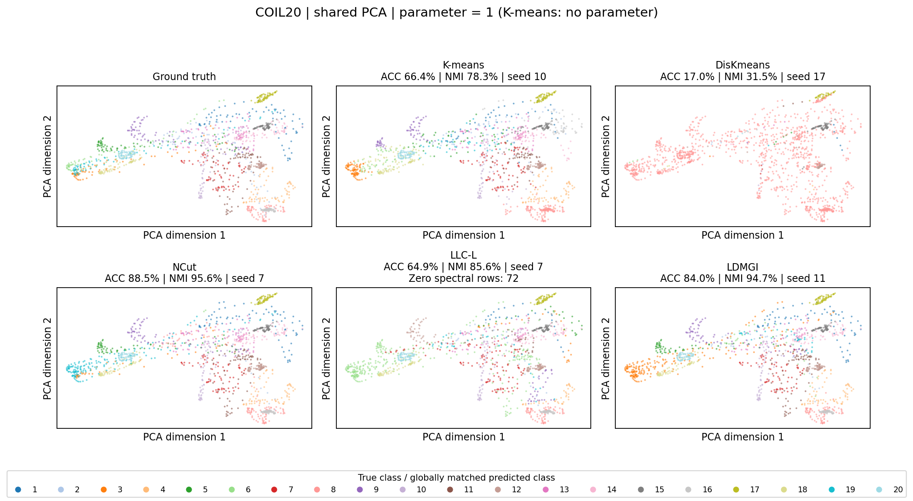
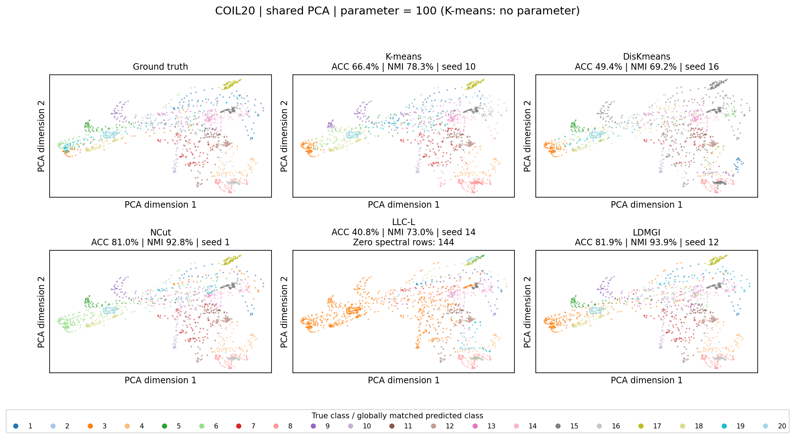
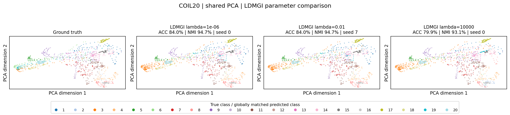
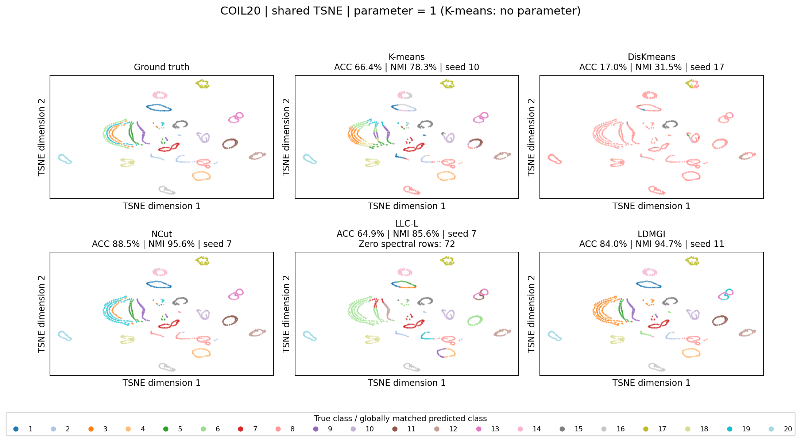
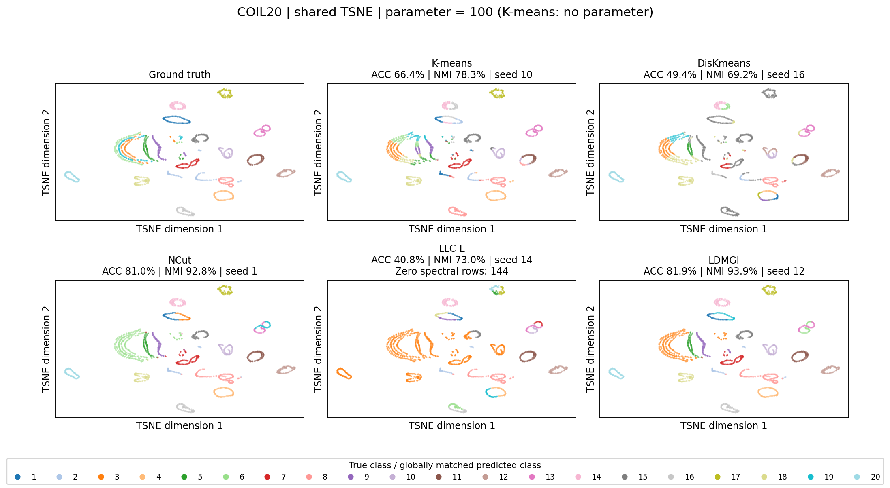
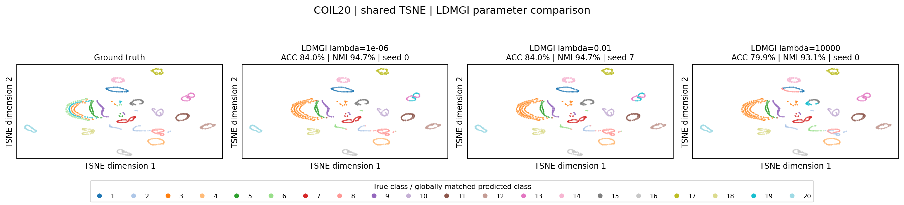

# Shared-coordinate cluster visualizations

PCA and t-SNE are fitted once on the dataset features without labels. Every method and parameter uses the same coordinates and axis limits. Only colors change. All samples are shown.

The two main comparisons fix the numeric parameter at 1 and 100; this means lambda for LDMGI, gamma for DisKmeans, eta for LLC-L, and bandwidth sigma for NCut. These parameters have different meanings. K-means has no corresponding parameter and is repeated unchanged.

The additional LDMGI comparisons use lambda=1e-6, 1e-2 and 1e4. Runs are selected by the method objective, not by the projection or plotting quality. Colors use global Hungarian matching for visual comparison to true classes.

t-SNE uses PCA-50 input, perplexity 30, PCA initialization, seed 0 and 1000 iterations. Distances between t-SNE groups and their sizes should not be read as quantitative evidence of clustering quality. Neither projection changes clustering or ACC/NMI.

